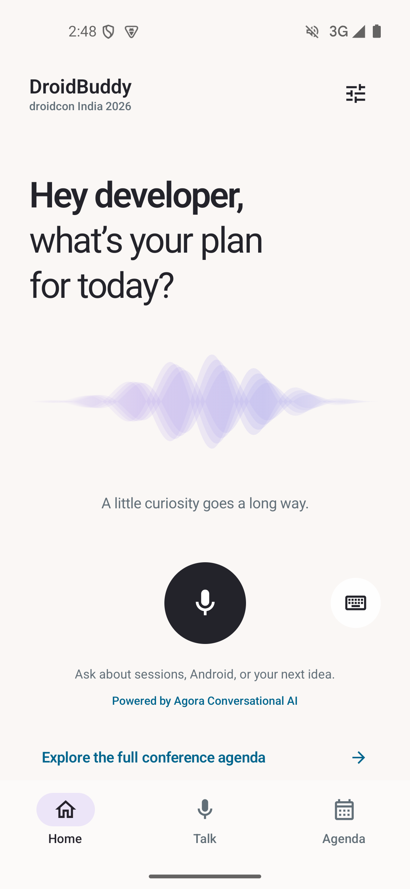
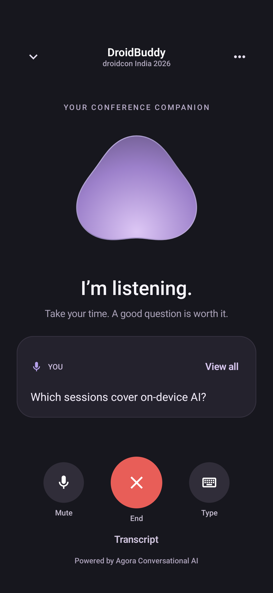

# DroidBuddy

**Talk. Discover. Connect.** — Powered by Agora Conversational AI.

A hands-on Voice AI demo by **Akshay Nandwana, Google Developer Expert in Android**. Built for developer advocacy: learn how to bring a real conversational voice agent into a Kotlin and Jetpack Compose app, then adapt it for your own ideas.

DroidBuddy is a companion for droidcon India 2026. Ask about Android, Kotlin, Compose or the published conference schedule. Browse all **67 published agenda entries and 52 speakers** offline, search rooms and talks, and save a personal session plan on your device.

 

The voice image is a UI preview with sample transcript, not evidence of a live agent call.

## Build your own demo

No Firebase, Python server, hosting or tunnel is required. Each developer uses their own Agora project and builds their own private APK.

```bash
git clone https://github.com/anandwana001/droidbuddy.git
cd droidbuddy
```

1. Open this existing project in Android Studio with its bundled JDK and Android SDK 36.1.
2. Enable Conversational AI and RTM for your Agora project.
3. Add credentials to the ignored root `local.properties`, alongside `sdk.dir`:

```properties
AGORA_APP_ID=YOUR_32_CHARACTER_APP_ID
AGORA_APP_CERTIFICATE=YOUR_32_CHARACTER_APP_CERTIFICATE
# Optional: unlock Hindi speech through Murf
MURF_API_KEY=YOUR_MURF_API_KEY
```

4. Build and install using Android Studio, or run:

```bash
./gradlew :app:testDebugUnitTest :app:assembleDebug
```

5. Tap **Voice language** on Home to choose English or Hindi, then tap the microphone and grant access. Once installed, the phone needs only internet; your laptop can be disconnected. Language is saved locally and can be changed between conversations.

See [configuration template](local.properties.example), [setup](docs/setup.md) and [troubleshooting](docs/troubleshooting.md).

## Voice pipeline

| Language | Recognition | Language model | Speech |
| --- | --- | --- | --- |
| English | Agora ARES (`en-US`) | Agora-managed OpenAI GPT-4o mini | Agora-managed MiniMax |
| Hindi | Agora ARES (`hi-IN`) | Agora-managed OpenAI GPT-4o mini | Murf, Neeta voice (`hi-IN`) |

Hindi requires your own Murf key; its option stays disabled without one. ARES replaces Deepgram for both languages. The Murf payload follows [Agora’s documented integration](https://docs.agora.io/en/ai/models/tts/murf), including its `FALCON` model selector. Provider availability and billing depend on your accounts. The Hindi/Murf live speech path remains unverified until tested with a valid Murf account.

Android starts/stops the agent through Agora Conversational AI REST v2. RTC carries audio; RTM carries state, transcripts and metrics. The app retains interruption, mute, text questions, read-aloud, renewal and cleanup. Conversations end locally after 14 minutes; the agent also has a 30-second idle timeout. No recording is enabled by this app.

## Demo security and scope

Credentials are deliberately compiled into this private demo APK, as a clone-and-run learning tradeoff. They can be extracted from an APK. Never commit `local.properties` or distribute a credential-bearing APK; use a disposable test project. Agora and Murf usage may incur charges. A public product needs server-owned credentials and authenticated orchestration.

Speech and transcript content are processed by Agora and the configured providers. Agenda bookmarks and language preferences stay on the device. There is no account, résumé/PDF upload, developer directory, QR networking, Firebase deployment or private backend in this version. The agent cannot read your saved agenda bookmarks. These boundaries keep the demo focused on Voice AI.

## Explore the implementation

- [Architecture](docs/architecture.md): REST lifecycle, RTC/RTM and token handling.
- [Agenda import](docs/AGENDA_IMPORT.md): verified source and refresh process.
- [Release checks](docs/RELEASE_CHECKLIST.md): build, device and provider verification.

```bash
python3 -m unittest discover -s scripts/tests
./gradlew :app:testDebugUnitTest :app:lintDebug :app:assembleDebug
```

Device tests require an emulator or physical phone. Live credential-dependent tests are opt-in; see the release checklist.

## Credits

Adapted from [Agora’s Android Conversational AI quickstart](https://github.com/AgoraIO-Conversational-AI/agent-quickstart-android). Preserves its RTC/RTM session foundations. Original MIT attribution is retained in [license.md](license.md).

This is an independent developer demo. GDE status does not imply Google endorsement; no official droidcon sponsorship or co-brand approval is claimed. Official brand assets require their owners’ approval.
